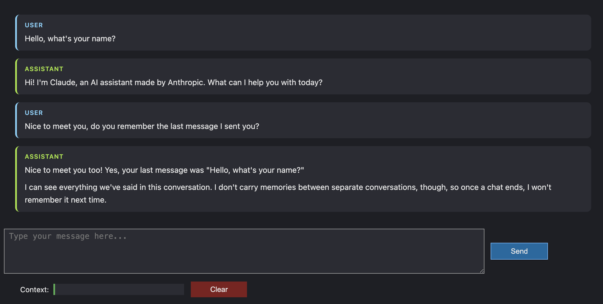

# TinyAgent on Claude

A minimal conversational agent with memory, built in a Jupyter notebook as part of the RagPack.ai *Introduction to AI Agents* course.

The course version runs on a local Ollama model through an OpenAI-compatible endpoint. This version calls the **Anthropic Messages API** directly with Python's standard library (`urllib`, no SDK) and adds a dark-themed chat UI.



## What's inside

| Component | Role |
|---|---|
| `AnthropicLLM` | Sends the conversation to `https://api.anthropic.com/v1/messages` and parses the reply |
| `Memory` | Stores the message history (`user` / `assistant` turns) |
| `TinyAgent` | Adds the user's message to memory, sends the full history to the LLM, stores the reply |
| `ChatUI` | ipywidgets chat interface with a context-usage bar and Clear button |

The key idea: the model has no memory of its own. Every call sends the **entire conversation** again, which is why the agent can answer "do you remember my last message?"

## Setup

```bash
pip install python-dotenv ipywidgets markdown
```

Create a `.env` file in the project root:

```
ANTHROPIC_API_KEY=your-key-here
```

Open `LLMs_and_Message_History.ipynb` and run all cells. Change the model in this cell if needed:

```python
Agent = TinyAgent(llm=AnthropicLLM(model="claude-opus-5-5"), memory=Memory())
```

**VS Code users:** install the **Jupyter** and **Jupyter Renderers** (`ms-toolsai.jupyter-renderers`) extensions, or the chat UI will render blank.

## Changes from the course notebook

- **`LLM` replaced by `AnthropicLLM`**: Anthropic endpoint, `x-api-key` and `anthropic-version` headers, API key loaded from `.env`.
- **Removed `reasoning_effort`**: it's an OpenAI/Ollama field. The Messages API rejects unknown fields with a 400.
- **Response parsing**: reads `content[-1]["text"]` and `usage` (`input_tokens` / `output_tokens`) instead of the OpenAI `choices[0].message` shape.
- **ChatUI redesign**:
  - Dark theme with message cards, rendered as HTML with markdown support
  - Errors from the API are shown in the chat instead of failing silently inside the button callback
  - A failed turn is removed from memory, so the next request doesn't send two `user` messages in a row

## Troubleshooting

| Symptom | Cause | Fix |
|---|---|---|
| `HTTP Error 400: Bad Request` | Request contains a field the API doesn't accept | Print `e.read().decode()` on the `HTTPError` to see which field |
| `HTTP Error 404: Not Found` | Model ID not recognised | Use a valid model ID (`GET /v1/models` lists them) |
| Auth error | API key is `None` | Make sure `load_dotenv()` runs and `.env` is in the project root |
| `chat_ui.show()` is blank in VS Code | Widget renderer missing | Install **Jupyter Renderers** and restart VS Code |


## Credits

Course material and the original `TinyAgent` / `Memory` / `ChatUI` structure: RagPack.ai. Anthropic API integration and UI changes are my own.
